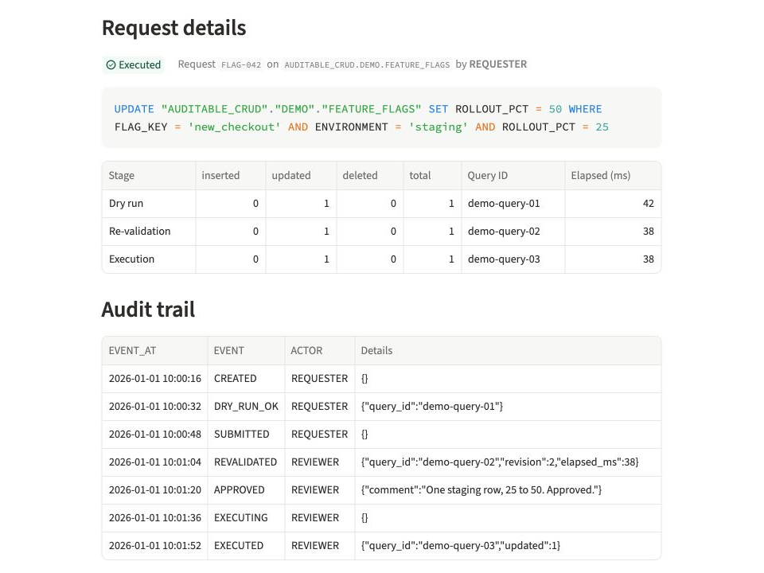

# Raise a staging feature rollout from 25% to 50%

The checkout team wants more staging traffic to use `new_checkout`. You and a reviewer will change one configuration row, preview its old and new values, and follow the change into the audit trail.

Use a disposable development installation with the [sample tables](../../bootstrap/10_seed_demo.sql) populated. You need the Developer app. Your reviewer needs the Admin app under a different Snowflake user. On a freshly seeded table, `new_checkout` is enabled at `25` percent in each of `dev`, `staging` and `prod`.

## 1. Open a request

In the Developer app, open **Choose table**. On the **FEATURE_FLAGS** card, select **Propose a change**. The **Change workbench** opens. Copy the request ID so your reviewer can find the same request later.

Expand **Show schema and sample of AUDITABLE_CRUD.DEMO.FEATURE_FLAGS**. Find the row for `new_checkout` in `staging`. Its `ROLLOUT_PCT` should be `25`. If this installation already has a different value, use a fresh copy of the demo for this lesson.

## 2. Preview one row

Select **Write SQL** and enter this statement in the DML editor.

```sql
UPDATE FEATURE_FLAGS
SET ROLLOUT_PCT = 50
WHERE FLAG_KEY = 'new_checkout'
  AND ENVIRONMENT = 'staging'
  AND ROLLOUT_PCT = 25;
```

Select **Dry run on the clone**. Under **Dry-run result**, open **Updated (1)** and inspect the row.

| Flag | Environment | Changed column | Before | After |
| --- | --- | --- | ---: | ---: |
| `new_checkout` | `staging` | `ROLLOUT_PCT` | 25 | 50 |

The counters should show one update, zero inserts and zero deletes. The source table still has the original value. If the preview differs, select **Discard request** and confirm **Yes, discard**.

## 3. Hand the change to your reviewer

Enter `Raise the staging checkout rollout to 50%` in **Note for the reviewer (optional)** and select **Submit for approval**. You can track the request under **My requests**.

Have your reviewer open **Review queue** in the Admin app and select the row matching your request ID. On **Review request**, they can read your note and the SQL. Under **Change set**, check that only the staging rollout changes. Select **Drift since dry run** to check for intervening changes. If any appear, select **Re-validate on current data** and inspect **Change set → Admin re-validation (current data)**. Continue only if the result still matches the row above.

Have the reviewer enter `Confirmed one staging rollout changes from 25 to 50` in **Comment (required)**, leave the allowed deviation at `0`, and select **Approve**. The request is now **Approved**. The staging value is still `25`.

## 4. Execute and read the record

In the Admin app, select **Execute on AUDITABLE_CRUD.DEMO.FEATURE_FLAGS**, check the target and expected count, and confirm **Yes, execute now**. This action writes the staging value `50` to the source table.

Open **History and audit**, select the same request and inspect **Audit trail**. Look for the requester on `SUBMITTED`, the reviewer on `APPROVED` and the executor on `EXECUTED`. The **Execution** row in the stage table shows one update and its Snowflake query ID.

In this example from the local demo, the stage table shows one updated row at execution. The audit trail records the requester and reviewer separately. Your request and query IDs will differ.



To repeat the lesson in this installation, open a new request to set the same staging row back to `25`. Change the final predicate to `ROLLOUT_PCT = 50` and preview, review and execute that one-row change. The original request remains in the audit trail.
